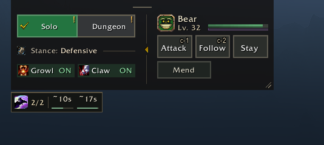

# Changelog

## v0.4.1

- Track up to two summoned hawks in a small tab beneath the pet panel. Each bird has a countdown and a shrinking bar. The first hawk to expire appears on the left and turns amber in its final three seconds. The tab hides when both birds are gone.
- A tilde marks an estimated timer when the game restricts summon information. An estimate can outlast a hawk that despawns early.
- Drag the tab outside combat to save its own position. Right-click to dock it again. Use `/fpm movehawks` with the panel visible to place the tab without summoning a hawk.

## v0.4.1-preview.3 · Local preview

- Drag the hawk tab outside combat to save an independent screen position. Right-click it to reattach. Use `/fpm movehawks` to position the tab without summoning a hawk.

## v0.4.1-preview.2 · Local preview

- Active hawks have a small tab just below the panel. Each timer has its own label and shrinking bar. An empty slot stays dim. The tab sits below the food picker while feeding and moves above the panel near the bottom of the screen.

## v0.4.1-preview.1 · Local preview

- An optional Summon Hawk badge uses the panel’s bottom margin. It shows the active count and each bird’s remaining seconds, soonest first, and disappears when empty. A tilde marks an estimated timer.

## v0.4.0

- Create custom profiles for your pet’s stance and autocasts. Pin skills and show their icons, names or both. The panel and optional minimap tooltip follow the pet’s current settings.
- Attack, Follow and Stay sit beside your profiles. Right-click a profile, command or care button to bind or clear a shortcut.
- See happiness, level, health and XP at a glance. Hover the pet badge for loyalty, diet and other readable details.
- Mend switches to Revive for a dead pet. A dismissed pet gets a portrait and a Call button. Click Feed outside combat to pick compatible food directly from your bags.
- Drag the top strip to move the panel or the lower-right corner to resize it. Collapse the pet controls to keep just the profiles and skills at the same height.
- The release screenshots show the control panel, pet tooltip and food picker in WoW Forever 1.60.1.

## v0.4.0-preview.18 · Local preview

- Collapsing pet controls removes the divider and leaves even margins around the profiles and skills. Click the arrow at the top right to reopen the controls. Panel height and skill placement stay the same.
- The resize corner uses two fine strokes that brighten on hover. The full corner still accepts a drag or a right-click.

## v0.4.0-preview.17 · Local preview

- Drag the unlocked panel by the full-width strip above the buttons, even with the title hidden.
- Drag the bottom-right grip to resize. Skills reflow as you drag and the panel remembers its size. Right-click the grip to return to automatic sizing.

## v0.4.0-preview.16 · Local preview

- Skill badges now share a width and wrap onto aligned rows as the panel narrows. Under **Panel → Skill display**, choose **Icon only**, **Name only**, or **Icon and name**. Each mode keeps the autocast state visible.

## v0.4.0-preview.15 · Local preview

- Click Feed to see bag icons and counts for food your pet can eat. Click an icon to feed one piece. Duplicate stacks share an icon.
- The stance now shows its native icon and a divider. Skill indicators pair spell icons with explicit ON, OFF and Unavailable labels.

## v0.4.0-preview.14 · Local preview

- When the pet controls are taller than the profile controls, the stance and ability rows use the available space beneath the profile buttons. Wrapped abilities keep their compact row spacing.

## v0.4.0-preview.13 · Local preview

- Dismissing your hunter pet replaces the control panel with a portrait and a single **Call <pet name>** button. The full panel returns when the pet does. Shift-click the card to revive a missing corpse if you have learned Revive Pet.

## v0.4.0-preview.12 · Local preview

- Added a purple pet XP bar beneath health. Hover the badge to see current and required XP. The bar hides when the pet has no XP goal.

## v0.4.0-preview.11 · Local preview

- The health bar draws WoW’s pet health percentage directly, including display-only values. Collapsing the pet column changes only the width.
- Right-click an action button outside combat to bind a key or remove a shortcut. The menu identifies native pet-bar slots and asks before taking a key from another action.
- One care button and shortcut switch between Mend, Revive and Call. The no-pet filter keeps learned recovery actions accessible when the pet is absent.

## v0.4.0-preview.10 · Local preview

- Group adjacent profile buttons into a single selector at compact spacing. The selected profile keeps its checkmark and configured color.
- Place the happiness face, name and level at the top of the pet column. A wider health bar sits beside the level. Hover anywhere on the badge for details.
- Align Attack, Follow and Stay below the badge with brighter shortcut labels. Care buttons have a quieter finish and a taller click area. The divider uses a small chevron with the same full-height click target.

## v0.4.0-preview.9 · Local preview

- Recall is now called Follow. Attack, Follow and Stay share a row and display their current pet-bar shortcuts. Hover for the full key name.
- The pet badge includes a live health bar. Learned Call, Revive, Mend and Feed actions appear according to the pet’s state. Click Feed and choose food in your bags.
- WoW’s Keybindings menu lists the three commands and four profile favorites. Solo and Dungeon start in slots 1 and 2. Assign custom profiles under their Advanced settings.

## v0.4.0-preview.8 · Local preview

- Restyle the pet-column divider with a bronze-rimmed circular handle and a directional arrow. Hovering anywhere along the divider highlights the handle.

## v0.4.0-preview.7 · Local preview

- Display the pet’s name and level beside its happiness face. Both lines fit within the face height, and hovering anywhere on the badge opens pet details.

## v0.4.0-preview.6 · Local preview

- Group pet controls in a collapsible right column and keep profiles, stance and autocasts together on the left. The divider remembers its position as open or closed.
- Standardize the outer margins, row gaps and ability spacing. Hover the happiness face for live pet details, including health, resource, loyalty, diet and unpinned autocasts when available.

## v0.4.0-preview.5 · Local preview

- Round button border thickness to whole screen pixels so the sides, top and bottom render evenly at fractional UI scales.

## v0.4.0-preview.4 · Local preview

- Recall now uses the same border thickness as the profile buttons and keeps its icon inside the border.

## v0.4.0-preview.3 · Local preview

- Move Recall to the right of the profile controls and use the pet bar’s Follow icon. Group the happiness face with the stance and keep the ability indicators underneath.

## v0.4.0-preview.2 · Local preview

- Show Blizzard’s native happiness face beside the stance. Hover it for the mood name. The minimap tooltip includes the matching icon.

## v0.4.0-preview.1 · Local preview

- Duplicate, rename and remove custom profiles in settings.
- Pin abilities for the panel and minimap tooltip. Growl stays first.
- Hover the minimap button to see current profile matches, stance, autocasts and pet happiness.
- Show your hunter pet's happiness on the panel and optionally add a separate Recall button for Follow.

## v0.3.3 · 2026-11-24

- Outside combat, left-click the minimap button to hide or show the Solo/Dungeon panel. Right-click opens settings.
- To swap the clicks, open /fpm, go to **Panel**, change **Show/hide panel with** to **Right-click**, and save. You can enable the optional **Minimap button** on the same tab.
- The panel remembers a manual hide across reloads. Showing it restores your usual visibility rules. The minimap controls were tested in-game before release.

## v0.3.2 · 2026-11-23

- Display the installed addon version beside the title in the settings window.
- Added CurseForge listing materials and in-game screenshots of both default modes.

## v0.3.1 · 2026-11-23

- Register the optional minimap button with the shared launcher libraries used by EnhanceQoL’s button bin.
- Leave positioning to the collector while grouped. Retain standalone behavior and saved settings for installations without the libraries.

## v0.3.0 · 2026-11-23

- Show the panel only on Hunters by default. The account-wide setting can be changed from any class with /fpm.
- Added an optional draggable minimap settings button. It follows the class filter, remembers its position, and remains accessible when the main panel is hidden by its pet or instance filters.

## v0.2.0 · 2026-11-23

- Added a checkmark for a full profile match and an amber availability marker with hover details.
- Put Growl first in the compact autocast row. Hover an ability to see how each profile treats it.
- Replaced settings paging with named tabs and added a three-choice picker for pet abilities. Advanced retains color, icon and raw-rule controls.
- Recheck the native stance target and pet at click time, discard stale confirmation callbacks on pet changes and shorten oversized macros when some settings already match.

## v0.1.2 · 2026-11-21

- Recognize the Forever pet button labeled Defensive, including its DefensiveAssist token. This restores the Solo binding and its Growl ON command on affected pet bars.
- Keep click feedback on the profile buttons. The panel shows current pet state and ability flags. Troubleshooting details are available on hover.

## v0.1.1 · 2026-11-21

- Added live stance and autocast indicators beneath the buttons, including unavailable configured abilities.
- Moved click feedback onto the panel. Hover previews the profile's requested settings.
- Clear the previous highlight during a switch and recheck delayed pet-bar updates. A superseded click cannot overwrite the latest result.
- Treat numeric zero as an inactive pet-bar flag. Added regression tests for the Dungeon-to-Solo transition.

## v0.1.0 · 2026-11-21

- Added Solo and Dungeon profiles with exact pet-bar matching and manual fallback feedback.
- Added a movable panel with saved appearance, visibility, position and profile rules.
- Added in-game settings, a pet-status command, Lua fixture tests and automated release packaging.
- Targeted Forever 1.60.1, interface 16001. The native UI source was reviewed at build 71037. Live-client acceptance is pending.
