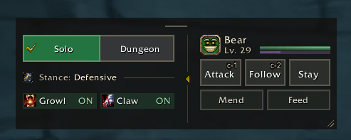

# Forever Pet Modes

Manage hunter pet profiles, commands, health and feeding in **World of Warcraft: Forever**. The panel reads the pet action bar after a click and when the game reports changes. A checkmark and the profile color mark a complete match.

| Button | Pet stance | Growl autocast | Active appearance |
| --- | --- | --- | --- |
| Solo Mode | Defensive | On | Green with a checkmark |
| Dungeon Mode | Passive | Off | Blue with a checkmark |



Turn off Growl on the pet bar while still in Defensive and both buttons lose their highlight. Select Passive and Dungeon lights up. If you configure two identical profiles, both highlight when their rules match.

## Install v0.4.0

1. Download **ForeverPetModes-v0.4.0.zip** from the [release](https://github.com/jamesk111/ForeverPetModes/releases/tag/v0.4.0).
2. Close WoW and extract the ZIP into `World of Warcraft/_forever_/Interface/AddOns/`. The resulting file path should end in `AddOns/ForeverPetModes/ForeverPetModes.toc`.
3. Start Forever, enable **Forever Pet Modes** in the AddOns list and log in. Summon a pet. Place its stance controls and Growl on the Blizzard pet action bar.
4. Click a profile with the left mouse button and no modifier keys, outside combat. Hover to preview the target stance and autocast settings. Read the live stance and each ability’s ON/OFF indicator beneath the buttons. Type `/fpm status` to inspect the current stance, spell IDs, autocast values and profile matches.

Target client **1.60.1**, interface **16001**. The release screenshots show the panel, pet tooltip and food picker in-game. Automated tests cover addon behavior and packaging. The [live-client checklist](docs/development.md#manual-acceptance-on-forever) covers protected commands, combat and persistence.

## Configure the panel

### Profiles, pet commands and care

Open `/fpm` outside combat. Changes take effect when you click **Save**.

- **Custom profiles.** Open Solo, Dungeon or an existing custom profile and click **Duplicate profile**. Give the copy a name, choose its stance and autocasts, and save. **Remove profile** stages removal of a custom profile. **Cancel** discards the draft. Profiles with identical settings can both match.
- **Skill display.** Under **Panel → Skill display**, choose **Icon only**, **Name only** or **Icon and name** (default). Badges share a width across rows and wrap to the available space. Each keeps its ON, OFF or Unavailable label. Hover for the full skill name.
- **Ability pins.** Under **Panel → Ability indicators**, select **Pinned abilities**. Scroll to the ability names immediately below and click the ones to keep. Growl stays visible when available or configured. Pins apply to the panel and minimap tooltip and follow trained ranks. **All abilities** is the default.
- **Minimap status.** Hover the enabled minimap button for matching profiles, stance, ability states and happiness. **Custom** means the current stance and autocasts match none of your saved profiles. The tooltip works while the main panel is hidden.
- **Pet controls.** The left column shows profiles, stance and ability states. The right column holds commands, the pet badge and care buttons. Outside combat, click the divider to hide the right column. Click the arrow at the top right of the folded panel to bring it back. Profiles and skills stay in place, and the panel remembers your choice.
- **Attack, Follow and Stay.** Turn on **Panel → Pet command buttons** to show the three commands. Each displays the shortcut for its current Blizzard pet-bar slot. For example, if Follow is bound to Ctrl+2, the corner shows the compact key and hovering shows the full name. The shortcut follows a rebind or a slot move. If there is no native shortcut, the button shows its optional addon shortcut, or stays blank when neither is bound.
- **Pet details.** The badge shows Blizzard’s happiness face on the left, with the pet’s name above its level on the right. Hover the face or either text line for the full name, level, family, health, resource, happiness, matching profiles, stance, autocasts, loyalty and diet when available. This view includes unpinned autocasts. An **i** provides the same tooltip when the game has no mood to report. Turn off **Panel → Pet happiness** to hide the badge and the minimap mood.
- **Health and care.** A smaller purple bar below health shows pet XP toward the next level. Hover the badge for exact XP. The health bar beside the level uses WoW’s native pet health percentage. With **Pet care buttons** enabled, the left care button offers Mend for a living pet, Revive for a dead pet and Call for an absent pet as you learn those spells. One shortcut follows all three. Click **Feed** outside combat to open the food picker just below the panel. Click an item icon to feed one piece. The count combines usable stacks of that food in your bags. Hover for the bag tooltip. Click Feed again to close the picker. Dismissing your pet replaces the entire panel with its portrait and **Call <pet name>**. Click anywhere on the card to summon it. Shift-click for Revive if its corpse has disappeared. The panel returns to its previous layout when your pet appears. The card remembers the last known pet per hunter and shows **Call Pet** until it learns a name. **Hide without a pet or care action** keeps the panel accessible when Call or Revive is available. Manual hide, class and instance settings still apply.
- **Profile spacing.** Adjacent profiles share a continuous row at button spacing 0–4. Choose a larger value under **Panel → Advanced → Button spacing** for separate buttons. The active checkmark and saved profile colors work with either style.
- **Keyboard shortcuts.** Outside combat, right-click a profile, pet command or care button. Select **Bind a key…** and press a key, or choose **Unbind** beside an existing shortcut. Escape cancels. Replacing another action requires clicking **Replace**. When the menu names a Blizzard pet-bar slot, the change also applies to that native slot. Profile shortcuts use unmodified keys outside combat. Solo and Dungeon start as favorites 1 and 2. A custom profile can bind directly. Favorite shortcuts follow the owner of that favorite. WoW’s **Options → Keybindings → AddOns → Forever Pet Modes** also lists the commands, care actions and favorites.

### General settings

Type **`/fpm`** outside combat. The settings header shows the version loaded by the client. Include it when reporting a bug. Choose **Panel**, **Solo** or **Dungeon**. Each tab has an **Advanced** view. **Hunters only** is enabled by default, including on upgrade. Turn it off on the Panel tab to use the addon on another class. The settings command remains available on every class. **Save** applies all pages together. **Cancel** or Escape discards the draft. **Reset to defaults** stages the original position and both default profiles for review before saving.

| Page | Controls |
| --- | --- |
| Panel | Size, scale, layout, position lock, icons, title, visibility and confirmation sound |
| Panel → Advanced | Spacing, border thickness, background opacity and inactive color |
| Solo / Dungeon | Button label, pet stance, ability names and icons with three autocast choices |
| Profile → Advanced | Active color, icon file ID and raw spell-ID rules |

To enable the minimap button, turn on **Panel → Minimap button** and click **Save**. Outside combat, left-click the bubble to hide or show the Solo/Dungeon panel. Right-click opens settings. To swap those actions, set **Show/hide panel with** to **Right-click** and save. The tooltip shows your current controls.

A manual hide persists across reloads. Showing the panel restores your usual visibility rules. Turning the minimap button off also clears a manual hide. EnhanceQoL’s minimap button bin can collect the launcher alongside your other icons. With no collector, drag the bubble along the minimap edge to reposition it. The angle is saved account-wide. The bubble follows **Hunters only** and remains accessible when pet or instance filters hide the main panel.

Outside combat, drag the top strip to move the panel. When folded, the strip extends up to the expand arrow. A small handle marks the strip when the title is hidden. Drag the bottom-right corner to change the width and height. Skill badges reflow and the panel keeps enough height for its contents. Right-click the corner to restore automatic sizing. **Lock position** also locks the panel size. Set background opacity to `0` for a transparent panel. Position and settings are account-wide and saved by WoW on a normal logout or `/reload`.

Each ability has three choices. **Leave alone** preserves the current setting when you click the profile. **Turn on** and **Turn off** explicitly set autocast. For example, leave Bite alone on both tabs, turn Growl on for Solo and turn it off for Dungeon. Saved abilities stay editable when switching pets. Hover a live indicator to see which profiles control it. Growl stays first, and the other indicators wrap to fit.

Advanced ability rules use a comma-separated list such as `2649=on, 17253=off`. Use `/fpm status` for IDs on your current pet. Leave the field empty to manage stance alone. A rule can match another rank by the localized name of its configured spell ID. An ability must support autocast and be present on the pet bar. Put the corresponding ability there or edit the profile if you change pets.

## Clicks and combat

The addon builds an out-of-combat click from the current stance slot and the localized names of the required abilities. It requests explicit autocast on or off, so repeating a click preserves the intended setting. It checks the entire configuration before binding a button. An amber **!** marks an unavailable action or an incomplete switch. Hover for the specific reason. The addon checks the current pet, stance slot, native button and all required abilities again at click time. If a large macro exceeds the byte limit, it drops commands whose requested state already matches. Restoring a required ability clears its warning automatically.

If the client accepts only part of a click, the addon reads the result. The buttons reflect the result as the addon rechecks the live bar for up to 2.2 seconds. A partial match leaves both default buttons inactive. If the switch remains incomplete, compare the live rows with the target in the button tooltip. In combat, use the Blizzard pet bar. Highlighting continues when readable, and unavailable or restricted data clears the highlight. Zoning and leaving combat refresh visibility and bindings. All pet actions require a fresh player click.

## Architecture

The TOC loads twelve Lua modules into a shared addon-private namespace. Defaults supplies configuration data. PetState reads the pet bar and current pet. Profiles compares that snapshot against each profile. SecureActions prepares profile clicks and verifies their results. UI lays out and moves the panel. Indicators draws the ability chips and pet badge. PetControls configures command buttons, their binding labels and the contextual care spells. FoodPicker filters carried items for the current pet and targets the chosen bag slot on click. ButtonBindings handles context menus, key capture and saving. WoW loads the optional shortcuts from Bindings.xml. Settings validates draft edits and saved values. Minimap registers the launcher with LibDataBroker and LibDBIcon when available and supplies a standalone button otherwise. Core handles class visibility, the addon lifecycle and event-driven refreshes. See the [pet controls design](docs/adr/0003-pet-recall.md) for the binding and visibility decisions.

The compatibility research and Blizzard policy review are in [ADR 0001](docs/adr/0001-forever-secure-actions.md). A version tag publishes the tested ZIP to GitHub and submits the same bytes to CurseForge. See the [release design](docs/adr/0002-tagged-distribution.md) and [development guide](docs/development.md#publishing) for setup, verification and recovery.

## Run checks and build a ZIP

From the repository root with Lua 5.1 and Python 3 installed, run

```bash
lua5.1 tests/run.lua
python3 -m unittest discover -s tests
python3 tools/package.py 0.4.0
```

The packager expects the version in the checked-out TOC and writes the ZIP to `dist/`. There are no runtime dependencies beyond the game client.

## Troubleshooting and shutdown

- **Missing from the AddOns list.** Check the Forever folder and exact TOC path above. Fully restart the client after adding a new addon. Compare the installed interface using `/run print(select(4, GetBuildInfo()))`.
- **Panel missing.** Open `/fpm`, check Hunters only, no-pet, combat and instance visibility, or stage a reset and save.
- **Gray buttons.** Read `/fpm status`. A dead or missing pet, unavailable ability, partial match or restricted value can leave both inactive. Add the missing stance or spell to the native bar. Unknown stances remain unmatched.
- **Stance failed to change.** Select it on the Blizzard pet bar. If an autocast rule also differs, right-click the indicated ability there. Status should update after the native event. If another addon replaces the bar, reproduce with the default UI.
- **Disable or remove.** Disable Forever Pet Modes in the AddOns list and reload, or exit the game and remove its addon folder. Reset and save in `/fpm` first if you want the account settings returned to defaults.

Forever Pet Modes is free and distributed under the [MIT license](LICENSE).
