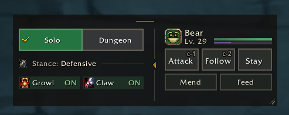
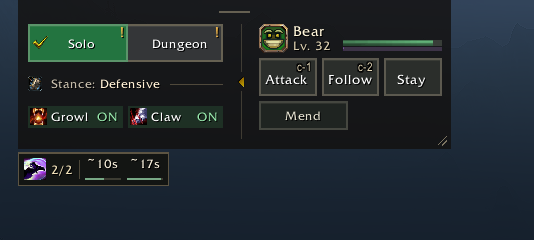

# Forever Pet Modes

## Project fields

| Field | Value |
| --- | --- |
| Project name | Forever Pet Modes |
| Game and class | World of Warcraft · Addons |
| Flavor and supported game version | Forever · 1.60.1 |
| Primary category | Hunter |
| License | MIT License |
| Project icon | [Project avatar](icon.png) |
| Source | [GitHub repository](https://github.com/jamesk111/ForeverPetModes) |
| Issues | [Bug reports and feature requests](https://github.com/jamesk111/ForeverPetModes/issues) |
| Install file | [ForeverPetModes-v0.4.1.zip](https://github.com/jamesk111/ForeverPetModes/releases/download/v0.4.1/ForeverPetModes-v0.4.1.zip) |

## Summary

A hunter pet control panel for WoW Forever. Switch profiles, track stance and autocasts, command your pet, and feed it from your bags.

## Description

Switch your hunter pet from solo play to a dungeon with one click. The panel shows its current stance and which abilities have autocast on. A checkmark tells you when the pet matches a profile, even after a manual change on the pet bar.

## Start with Solo and Dungeon

1. Summon your pet and put Growl and the stance controls on its pet bar.
2. Outside combat, click **Solo** for Defensive stance with Growl on, or **Dungeon** for Passive stance with Growl off.
3. Type `/fpm` to customize the panel and save your settings. It appears on Hunters by default.

## Pet commands and care

- **Attack, Follow and Stay** are beside the profiles. Right-click a command, profile or care button outside combat to set its shortcut.
- **Mend** changes to **Revive** when your pet dies. When you dismiss your pet, click its portrait to call it back.
- **Feed** opens a row of food your pet can eat. Outside combat, click a food icon to feed one piece from your bags.
- **Pet status** shows happiness, level, health and XP. Hover over your pet’s badge for loyalty, diet and other details.

## Summon Hawk timers

Each active hawk gets a countdown. The hawk on the left expires first. In the screenshot, **2/2** means both hawks are out. The **~** before a time means it’s an estimate.

Drag the timer outside combat. If you have no hawks out, leave the pet panel visible and type `/fpm movehawks`. The empty timer appears. Drag it where you want it and release to save its position. Right-click it to attach it to the panel again.

## Customize the panel

In `/fpm`, duplicate a profile to choose its stance and autocasts. Pin skills, show icons or names, resize the panel, or fold away the pet commands. If you enable the minimap button, left-click it to show or hide the panel and right-click for settings. You can swap those clicks.

[See the food picker and pet details in the gallery](https://www.curseforge.com/wow/addons/forever-pet-modes/gallery) · [Report an issue or suggest a feature](https://github.com/jamesk111/ForeverPetModes/issues) · [Source code](https://github.com/jamesk111/ForeverPetModes)

## Gallery captions

- [Pet control panel](control-panel.png) — Solo is active. Bear’s health and XP appear beside its level, above the commands and care buttons.
- [Pet details](pet-details.png) — Hover the pet badge to see happiness, experience, loyalty, diet and autocasts.
- [Feed Pet](food-picker.png) — Click Feed to see food your pet can eat and how much you have in your bags.
- [Summon Hawk timers](hawk-timers.png) — Both hawks are out (2/2). Their estimated time remaining is 10 and 17 seconds, with the first to expire on the left.
