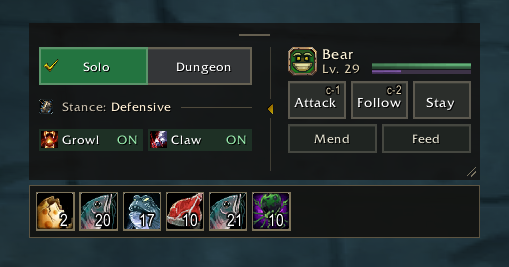
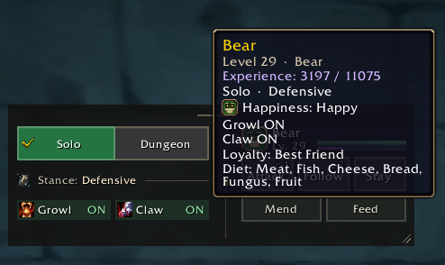

# Forever Pet Modes

## Project fields

| Field | Value |
| --- | --- |
| Project name | Forever Pet Modes |
| Game and class | World of Warcraft · Addons |
| Flavor and supported game version | Forever · 1.60.1 |
| Primary category | Hunter |
| License | MIT License |
| Project icon | [Project avatar](icon.png) |
| Source | [GitHub repository](https://github.com/jamesk111/ForeverPetModes) |
| Issues | [Bug reports and feature requests](https://github.com/jamesk111/ForeverPetModes/issues) |
| Install file | [ForeverPetModes-v0.4.0.zip](https://github.com/jamesk111/ForeverPetModes/releases/download/v0.4.0/ForeverPetModes-v0.4.0.zip) |

## Summary

A hunter pet control panel for WoW Forever. Switch profiles, track stance and autocasts, command your pet, and feed it from your bags.

## Description

Forever Pet Modes puts your hunter’s pet profiles, commands and care in one compact panel for World of Warcraft: Forever.

Heading into a dungeon? Click **Dungeon** outside combat for Passive stance and Growl off. Click **Solo** for Defensive stance and Growl on. A checkmark shows when your pet matches the profile. If you change Growl on the pet bar, the panel shows the new state right away.

**Make it yours.** Duplicate a profile to create your own stance and autocast rules. Pin the abilities you care about, choose icons, names or both, and resize the panel from the bottom-right corner. Fold away the pet commands whenever you just want to see profiles and skills.

**Command and care for your pet.** Click Attack, Follow or Stay. Mend changes to Revive when your pet dies, and a dismissed pet gets a portrait you can click to call it back. Click Feed outside combat to see compatible food from your bags, then click an item to feed one piece. Right-click a command, care or profile button to manage its shortcut.

**Check on your pet.** The pet badge shows happiness, name, level, health and progress toward the next level. Hover for details such as loyalty, diet and autocast states.

**Getting started.** Summon your pet and put Growl and the stance controls on its pet bar. Type /fpm outside combat to configure the panel. If you enable the minimap button, left-click it to show or hide the panel and right-click for settings. You can swap those clicks. The addon shows on Hunters by default.

[Report a bug or request a feature](https://github.com/jamesk111/ForeverPetModes/issues).

## Gallery captions

- [Pet control panel](control-panel.png) — Solo is active. Bear’s health and XP appear beside its level, above the commands and care buttons.
- [Pet details](pet-details.png) — Hover the pet badge to see happiness, experience, loyalty, diet and autocasts.
- [Feed Pet](food-picker.png) — Click Feed to see food your pet can eat and how much you have in your bags.
